===============[ Configuration 1 — SCHED_FIFO ]===========

Priorités : 93, 92, 91, 90
Cœurs : 0, 0, 0, 0

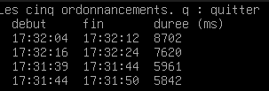

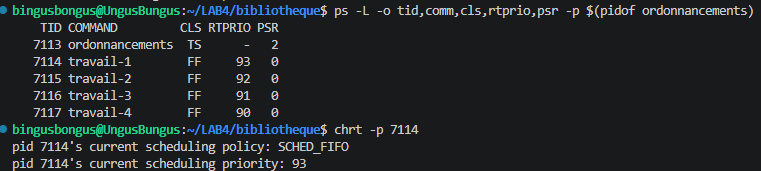

Les taches s'executent une par une selon leur ordre de priorité. Ils sont sur un même coeur donc doivent attendre leur tour.

==============[ Configuration 2 — SCHED_FIFO ]==============

Priorités : 90, 90, 90, 90
Cœurs : 0, 0, 0, 0

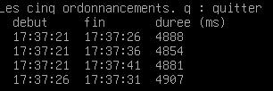

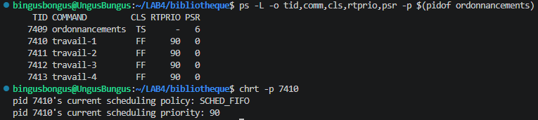

Les taches s'executent une par une selon leur ordre de priorité qui est 90. L'ordre varie entre les essais.
C'est entièrement dépendant sur qui arrive dans la file du CPU en premier.

===============[ Configuration 2b — SCHED_FIFO ]===============

Priorités : 90, 90, 90, 90
Cœurs : 0, 1, 2, 3

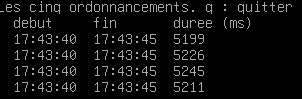

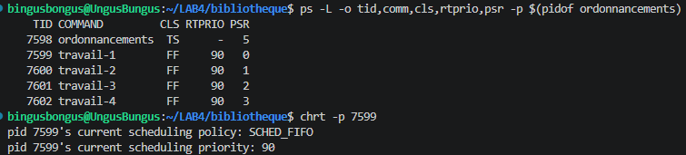

Les taches s'exécutent en parallèles puisqu'ils ont chacun un coeur différent du CPU donc n'ont pas besoin d'attendre leur tour.

==============[ Configuration 3 — SCHED_RR ]====================

Priorités : 90, 90, 90, 90
Cœurs : 0, 0, 0, 0

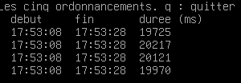

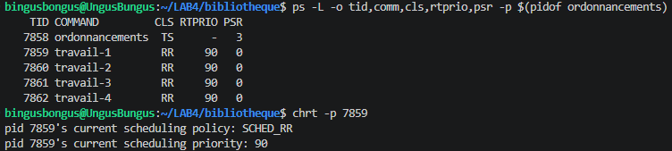

Les tâches s'exécutent en parallèles, mais doivent se partager le CPU puisqu'ils ont tous la même priorité et sont sur le même coeur.
Le temps d'exécution est donc multiplié par 4.

================[ Configuration 4 — SCHED_RR ]===================

Priorités : 90, 90, 90, 91
Cœurs : 0, 0, 0, 0

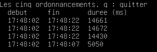

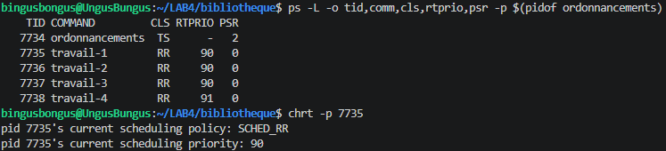

La tâche 4 s'exécute en premier puisqu'elle possède une plus haute priorité. Les 3 autres doivent l'attendre.
Ensuite les 3 tâches restantes doivent se partager le CPU puisqu'ils ont la meme priorité. Le temps d'exécution est donc multiplié par 3.

================[ Configuration 5 — SCHED_OTHER ]=================

Priorités : 0, 0, 0, 0
Cœurs : -1, -1, -1, -1

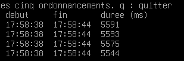

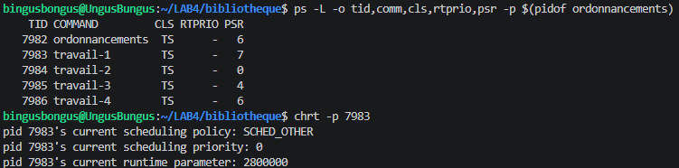

Les tâches n'ont pas de priorité spécifié ni de coeur désigné. Linux décidera donc comment procéder. Les tâches peuvent alors être divisé parmi 4 coeurs différents du CPU et s'exécutent en parallèles de façon simultané.

======================[ Race Condition & Checksum ]==========================

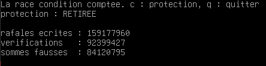

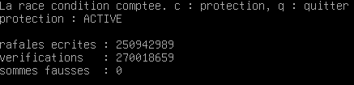

Le fait d'utiliser le mutex (protection) fait en sorte que seulement le thread qui a appelé la méthode de la table puisse lire ou écrire les valeurs de la table jusqu’à ce que le mutex soit libéré à la fin de la méthode. Cela évite de lire ou d'écrire des valeurs pendant que d'autres methodes y ont accès ce qui cause des problèmes concurences.